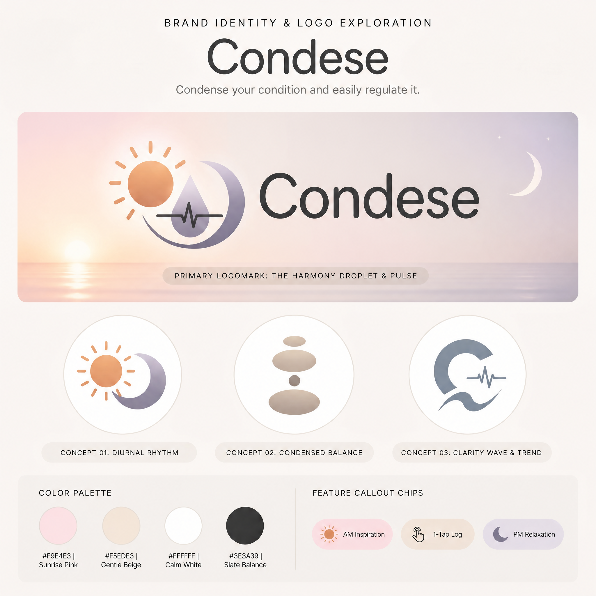

# Condese（コンディーズ）

## 概要
朝晩のちょっとした記録を通じて心身のコンディションの傾向を可視化し、日々のセルフケアや生活リズムを整えることをサポートするWebアプリケーションです。

## サイトテーマ
「状態（Condition）をぎゅっと凝縮して（Condense）気楽に整える（Ease）」

### テーマを選んだ理由

#### 【きっかけ】
日々のデスクワークの中で、なんとなく感じるだるさやコンディションの波が、日中の集中力や生産性に大きく影響していることに気づいたためです。気楽に続けられる仕組みで、無理なく心身のケアができるようにしたいと考えました。

#### 【問題点】
体調やメンタル・集中力などの変化を「なんとなく」でやり過ごすと、不調の傾向に気づきにくく、休息や切り替えの行動をとりにくくなります。また、長い日記は負担が大きく続きにくいほか、自分の状態に目を向ける余裕を確保しにくくなります。

#### 【解決策】
朝晩の数秒〜ワンタップでできる手軽な記録によって、体調や気分の波をグラフやカレンダーで振り返れるようにします。朝は気持ちを切り替える名言などの短いメッセージや、天気・気圧など心身の調子に関わる目安を確認でき、夜は記録に応じたメッセージやストレス解消・気分転換のヒントを見られるようにすることで、心身のケアを無理なく続けられる環境をつくります。

## ターゲットユーザ
- デスクワーク中心で、日中の集中力やコンディションの波を感じやすい人  
- 長い記録は続かないが、数秒〜ワンタップの手軽な習慣なら続けられそうな人  
- 自分の体調・メンタルの傾向を知り、日々のセルフケアや生活リズムを整えたい人  

## 主な利用シーン
- **起床時・朝の支度中：** 名言などの短いメッセージや、天気・気圧など心身の調子に関わる目安を確認し、気持ちを切り替えて1日を始める。  
- **就寝前・一日の終わり：** ワンタップでその日の体調・メンタルを記録し、状態に応じたメッセージや気分転換・ストレス解消のヒントを見て気持ちを落ち着かせる。  
- **振り返りのタイミング：** カレンダーやグラフで過去の記録を見返し、調子の波や傾向を把握する。
